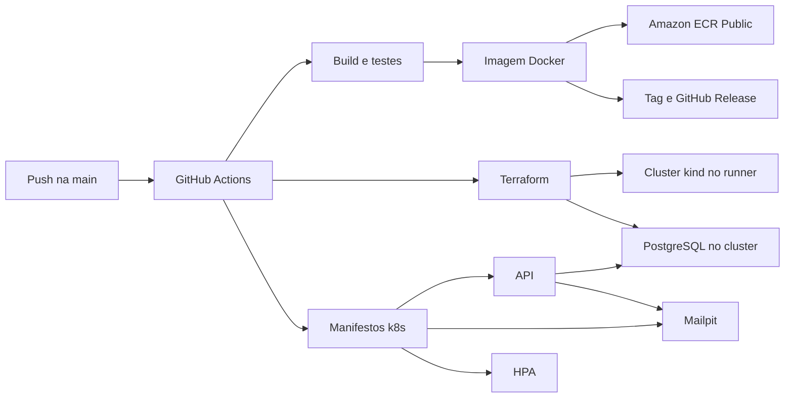

# Auto Repair Shop

API de uma oficina mecânica (FIAP Tech Challenge, fases 1 e 2). Um único deployável em Kotlin e Spring Boot registra clientes, veículos, estoque e ordens de serviço, conduz o orçamento até a entrega do carro e avisa o cliente por e-mail. A fase 2 abre a ordem numa chamada só, recebe a decisão do orçamento de um sistema externo, organiza a fila de trabalho e sobe o mesmo deployável em Kubernetes, com o banco provisionado por Terraform e a imagem publicada por um pipeline.

Pacote raiz: `br.com.autorepairshop`. Banco: PostgreSQL 16. Autenticação: JWT. E-mail local: Mailpit.

## O que a oficina faz neste sistema

1. O primeiro acesso cria um `MANAGER`. Esse usuário cadastra recepção e mecânicos.
2. A recepção cadastra o cliente. O sistema manda um convite para o e-mail de contato. O cliente escolhe a senha e vira um usuário `CLIENT`.
3. A recepção cadastra o veículo (placa brasileira, um dono) e o estoque de peças e insumos.
4. A ordem de serviço nasce de um cliente e um veículo. Pode ser aberta só com documento e placa, quando os dois já existem, ou numa chamada só com cliente, veículo, serviços e peças. A resposta traz o id da OS.
5. O mecânico inicia o diagnóstico. Nesse momento o orçamento passa a existir. Serviços, extras e peças compõem o total.
6. Ao encerrar o diagnóstico, a OS fica aguardando aprovação. O cliente aprova, recusa ou negocia pela API, ou um sistema externo avisa a decisão com um token.
7. Com o orçamento aprovado, o mecânico executa, conclui e a recepção entrega o veículo. Cada mudança de status gera um e-mail para o contato do cliente.
8. A fila da oficina mostra o que ainda está em andamento, na ordem de prioridade abaixo. Ordens finalizadas e entregues saem da fila e continuam no banco, no histórico do cliente.

```
RECEIVED → IN_DIAGNOSIS → WAITING_APPROVAL → BUDGET_APPROVED → IN_EXECUTION → FINISHED → DELIVERED
                              ↘ BUDGET_REJECTED
```

| Status | Rótulo público | Lugar na fila |
|---|---|---|
| `IN_EXECUTION` | Execução | 1 |
| `BUDGET_APPROVED` | Orçamento aprovado | 2 |
| `WAITING_APPROVAL` | Aguardando Aprovação | 3 |
| `IN_DIAGNOSIS` | Diagnóstico | 4 |
| `RECEIVED` | Recebida | 5 |
| `BUDGET_REJECTED` | Orçamento recusado | 6 |
| `FINISHED` | Finalizada | fora da fila |
| `DELIVERED` | Entregue | fora da fila |

Dentro do mesmo status, a mais antiga vem primeiro. A consulta `GET /service-orders/{id}/status` devolve o código e o rótulo.

## Quem usa

| Papel | O que faz |
|---|---|
| `MANAGER` | Primeiro usuário do sistema. Cadastra a equipe, vê e altera o estoque, conduz a OS até a entrega. |
| `RECEPTIONIST` | Cadastra cliente, veículo e OS. Entrega o carro. Ajusta quantidade de estoque. |
| `MECHANIC` | Diagnóstico, execução dos serviços e registro de serviço extra. |
| `CLIENT` | Só nasce pelo convite. Vê os próprios dados, aprova orçamento e serviço extra. |

`POST /auth/users` é público somente enquanto o banco não tem nenhum usuário, e esse usuário precisa ser `MANAGER`. Conta `CLIENT` não se cadastra nessa rota.

## Como o código está organizado

Monólito em camadas, um módulo Gradle. O domínio não conhece Spring nem HTTP. Cada contexto de negócio tem `domain`, `application` e `infrastructure`. A borda HTTP fica em `api`.

| Contexto | Pacote | Responsabilidade |
|---|---|---|
| Access identity | `accessidentity` | Equipe, convite do cliente, JWT e refresh |
| Customer | `customer` | Cliente (CPF/CNPJ) e veículos |
| Service and execution | `serviceandexecution` | Ciclo de vida da OS e a fila |
| Budget | `budget` | Total do orçamento e a decisão, inclusive a notificação externa |
| Catalog | `catalog` | Serviços do diagnóstico e serviços extras |
| Input management | `inputmanagment` | Estoque da oficina (`Inventory`) e linhas de peça da OS (`Part`) |
| Shared | `shared` | Agregados, dinheiro, eventos e envio de e-mail |

Eventos de domínio rodam no mesmo processo: cadastro de cliente dispara o convite, item da OS recalcula o orçamento, mudança de status manda o e-mail. O desenho das camadas, das tabelas e das regras está em [docs/ARCHITECTURE.md](docs/ARCHITECTURE.md). A escolha do PostgreSQL está em [docs/adr/001-postgresql.md](docs/adr/001-postgresql.md).

## Como executar

Pré-requisito: Docker Desktop em execução. Copie [`.env.example`](.env.example) para `.env`. O Compose lê esse arquivo.

O código desta máquina sobe pelo Compose. A imagem publicada sobe pelo cluster, onde o HPA escala as réplicas.

### Projeto local, com Compose

Constrói a API a partir deste repositório e grava a imagem `auto-repair-shop:local`. Postgres e Mailpit sobem junto.

```bash
cp .env.example .env
docker compose up --build
```

| Serviço | Porta | Função |
|---|---|---|
| API | `8080` | Spring Boot. Swagger em http://localhost:8080/swagger-ui.html |
| Postgres | `5432` | PostgreSQL 16. O volume `postgres_data` guarda os dados |
| Mailpit | SMTP `1025`, UI `8025` | Caixa local dos convites e dos e-mails de status. http://localhost:8025 |

### Imagem publicada, no cluster

[`scripts/up-cluster.sh`](scripts/up-cluster.sh) sobe o kind `autorepairshop` e aplica os manifestos. A imagem da API sai de [`k8s/app/kustomization.yaml`](k8s/app/kustomization.yaml): `newName` é o registro e `newTag` é a versão. Depois que o pipeline publica a imagem no ECR Public, a action grava essa versão no `newTag` e envia o commit para a `main`. Para apontar o cluster local para outra release, troque o `newTag` e rode o script de novo.

Na raiz do repositório:

```bash
bash scripts/up-cluster.sh
```

No PowerShell, o `bash` do Windows entra no WSL. Use o Git Bash:

```powershell
& "C:\Program Files\Git\bin\bash.exe" scripts/up-cluster.sh
```

O script faz o seguinte:

1. Se o container `autorepairshop-control-plane` estiver parado, ele é iniciado de novo. Encerrar o container no Docker Desktop não apaga o cluster.
2. Se esse container não existir, o script baixa o nó `kindest/node:v1.37.0` definido em [`infra/kind-config.yaml`](infra/kind-config.yaml), cria o cluster, instala o metrics-server e deixa essa imagem com a tag da versão do Kubernetes.
3. Aplica [`k8s/`](k8s). O HPA mantém de 2 a 5 réplicas.

| Serviço | Endereço |
|---|---|
| API | http://localhost:30080 |
| Swagger | http://localhost:30080/swagger-ui.html |
| OpenAPI | http://localhost:30080/v3/api-docs |
| Mailpit | http://localhost:30025 |

O banco é o Postgres do cluster, separado do volume do Compose. O ConfigMap `api-config` não tem página: as variáveis da API saem com `kubectl --context kind-autorepairshop -n auto-repair-shop get configmap api-config -o yaml`.

No Docker Desktop aparece um container só, o nó. As réplicas da API rodam dentro dele. A oscilação de CPU e memória de cada réplica sai em `kubectl --context kind-autorepairshop -n auto-repair-shop top pods` e em `kubectl --context kind-autorepairshop -n auto-repair-shop get hpa`. Os percentuais do HPA são sobre o pedido do pod (`200m` de CPU e `512Mi` de memória), não sobre o gráfico do nó.

[`scripts/simulate-load.sh`](scripts/simulate-load.sh) baixa o alvo de CPU para 1%, gera tráfego e acompanha as réplicas subirem. O script imprime o comando que devolve o alvo para 70%.

### API no host

Útil para depurar no IDE. O banco e o Mailpit ficam no Docker. A API no host fala com `localhost`, não com o nome dos serviços.

```bash
docker compose up -d postgres mailpit
./gradlew bootRun
```

No Windows CMD ou PowerShell: `gradlew.bat bootRun`. A classe principal é `src/main/kotlin/br/com/autorepairshop/AutoRepairShopApplication.kt`.

### Parar e zerar

`docker compose down` para os containers. `docker compose down -v` também apaga o volume do Postgres. Com o banco vazio, o próximo `POST /auth/users` volta a ser público.

Variáveis, segredos e a diferença entre URL do host e URL de dentro do container: [docs/CONFIGURATION.md](docs/CONFIGURATION.md). Passo a passo de testes e problemas comuns: [docs/GETTING_STARTED.md](docs/GETTING_STARTED.md).

## Consumir a API

Com o Compose no ar, a API local responde em:

- Swagger: http://localhost:8080/swagger-ui.html
- OpenAPI: http://localhost:8080/v3/api-docs
- Saúde: http://localhost:8080/actuator/health/readiness

Com o cluster no ar, os mesmos caminhos ficam na porta `30080`.

Rotas, papéis e corpos de request estão em [docs/ENDPOINTS.md](docs/ENDPOINTS.md). Erros em RFC 7807 estão em [docs/ERRORS.md](docs/ERRORS.md).

As collections em [`http/`](http/) são lineares. Rode cada arquivo de cima para baixo. O IntelliJ HTTP Client e o REST Client do VS Code gravam token e ids nas variáveis globais.

| Arquivo | O que percorre |
|---|---|
| [http/auth.http](http/auth.http) | Primeiro `MANAGER`, login, refresh e o restante da equipe |
| [http/customer.http](http/customer.http) | Cliente, convite e veículos |
| [http/inventory.http](http/inventory.http) | Catálogo de peças e insumos |
| [http/service-order.http](http/service-order.http) | OS do diagnóstico até a entrega |
| [http/extra-service.http](http/extra-service.http) | Serviço extra descoberto na execução |
| [http/budget.http](http/budget.http) | Negociação do orçamento, numa OS à parte |
| [http/apresentacao.http](http/apresentacao.http) | Um Civic do cadastro até a entrega, para a demonstração |

Ordem da fase 1: **auth → customer → inventory → service-order → extra-service**. O `budget.http` pode rodar depois do `customer.http`. O `phase2.http` não depende dos outros: no banco vazio ele cria `gerente@oficina.com` com a senha `senha123`.

No convite, abra o Mailpit, copie o token do link `/invite/{token}` e cole no request seguinte.

A notificação externa não usa JWT. `POST /integrations/budget-decisions` leva o header `X-Notification-Token`. No ambiente local o valor é `local-budget-notification-token`.

## Kubernetes

Os manifestos ficam em [`k8s/`](k8s). `kubectl apply -k k8s` aplica a base e a aplicação no namespace `auto-repair-shop`.

| Manifesto | O que cria |
|---|---|
| `k8s/base` | Namespace, ConfigMap `api-config`, Secret `api-secret`, Postgres e o Service dele |
| `k8s/app/api.yaml` | Deployment `api` com 2 réplicas, probes em `/actuator/health/liveness` e `/readiness`, Service NodePort `30080` |
| `k8s/app/mailpit.yaml` | Mailpit, UI no NodePort `30025` |
| `k8s/app/hpa.yaml` | HPA de 2 a 5 réplicas, CPU 70% e memória 80% |

O Deployment usa a imagem definida em [`k8s/app/kustomization.yaml`](k8s/app/kustomization.yaml). Na máquina local, [`scripts/up-cluster.sh`](scripts/up-cluster.sh) cria ou religa o kind e aplica esses manifestos. A API fica em http://localhost:30080 e o Mailpit em http://localhost:30025. O metrics-server instalado pelo script alimenta o HPA.

O Secret em `k8s/base/secret.yaml` repete os valores de desenvolvimento do `.env.example`. Troque `JWT_SECRET` e `BUDGET_NOTIFICATION_TOKEN` antes de um ambiente compartilhado. O volume do Postgres nesse manifesto é `emptyDir`: os dados somem com o pod.

## Terraform

[`infra/`](infra) cria um cluster [kind](https://kind.sigs.k8s.io/) chamado `autorepairshop` e aplica o banco. A porta `8080` do host chega no NodePort `30080`. A porta `8025` chega no NodePort `30025`. O mesmo apply instala o metrics-server com `--kubelet-insecure-tls`, para o HPA enxergar CPU e memória.

Pré-requisitos: Docker, kind, kubectl, Terraform `>= 1.6` e bash.

O state fica no bucket `fiap-group123-auto-repair-shop-tfstate`, chave `auto-repair-shop/terraform.tfstate`, região `us-east-1`, com versionamento, bloqueio de acesso público e cifra AES256. Ele não entra no Git.

```bash
bash scripts/ensure-tfstate-bucket.sh
cd infra
terraform init
terraform apply
```

O apply sobe o cluster, o metrics-server e o PostgreSQL de `k8s/base`. A API entra no passo seguinte e o nó baixa a imagem publicada:

```bash
kubectl apply -k k8s --context kind-autorepairshop
kubectl --context kind-autorepairshop -n auto-repair-shop rollout status deployment/api
```

API: http://localhost:8080. Mailpit: http://localhost:8025. Para derrubar o cluster: `terraform destroy` dentro de `infra/`.

[`scripts/simulate-load.sh`](scripts/simulate-load.sh) baixa o alvo de CPU do HPA para 1% e gera tráfego, para a demonstração da escala. `kubectl -n auto-repair-shop get hpa -w` mostra as réplicas. O script imprime o `kubectl patch` que devolve o alvo para 70%.

O PostgreSQL deste projeto sobe no cluster. Não há instância RDS.

## CI/CD

| Workflow | Quando | O que faz |
|---|---|---|
| [pull-request-checks.yml](.github/workflows/pull-request-checks.yml) | Pull request e disparo manual | Compila, roda o Detekt em `main` e os testes com cobertura. Comenta a porcentagem no PR |
| [unit-tests.yml](.github/workflows/unit-tests.yml) | Chamado pelos outros workflows | `koverVerify`, mínimo de 80% de linha no núcleo |
| [sonar.yml](.github/workflows/sonar.yml) | `main` | Análise no SonarQube Cloud |
| [cd.yml](.github/workflows/cd.yml) | Push na `main`, tag `v*` e disparo manual | Checagens, imagem, release, cluster kind, banco e manifestos |

No CD, a imagem vai para o Amazon ECR Public. O pipeline lê a maior tag `vMAJOR.MINOR.PATCH` e calcula a próxima:

- um commit `feat:` sobe o minor (`v0.1.3` vira `v0.2.0`);
- `feat!:` ou `BREAKING CHANGE` sobe o major (`v0.1.3` vira `v1.0.0`);
- o restante sobe o patch (`v0.1.3` vira `v0.1.4`).

No disparo manual dá para escolher patch, minor ou major. A tag Git, a GitHub Release e a imagem usam essa mesma versão. A release nova também publica `latest`. Em seguida a action grava essa versão em `newTag` de [`k8s/app/kustomization.yaml`](k8s/app/kustomization.yaml) e envia o commit para a `main`. Esse commit não dispara outro deploy. Um push de uma tag que já existe só republica essa imagem.

Depois da publicação, o job sobe um kind efêmero no runner: Terraform cria o cluster e o Postgres, e `kubectl apply -k k8s` sobe a API com a imagem que acabou de ir para o ECR Public. O HPA escala essa imagem. O cluster some quando o job termina.

Variáveis `JAVA_VERSION` (`17`), `GRADLE_VERSION` (`9.5.1`), `AWS_REGION` (`us-east-1`) e o secret `AWS_ROLE_ARN` estão em [docs/CONFIGURATION.md](docs/CONFIGURATION.md#github-actions). A conta AWS, a role e o bucket do state estão em [docs/AWS.md](docs/AWS.md).



## Onde está cada assunto

| Documento | Conteúdo |
|---|---|
| [GETTING_STARTED.md](docs/GETTING_STARTED.md) | Subir, primeiro usuário, collections, testes, qualidade e problemas comuns |
| [ENDPOINTS.md](docs/ENDPOINTS.md) | Todas as rotas, papéis, request e response |
| [ERRORS.md](docs/ERRORS.md) | RFC 7807 e o status de cada exceção |
| [CONFIGURATION.md](docs/CONFIGURATION.md) | Variáveis, Compose, segredos e GitHub Actions |
| [AWS.md](docs/AWS.md) | OIDC, role, ECR Public e bucket do Terraform |
| [ARCHITECTURE.md](docs/ARCHITECTURE.md) | Camadas, contextos, fluxos, tabelas e ambientes |
| [ADR 001](docs/adr/001-postgresql.md) | Por que PostgreSQL |

## Stack

| | |
|---|---|
| Linguagem | Kotlin 2.4, JDK 17 |
| Framework | Spring Boot 4.1 (Web MVC, Security, JPA, Validation, Mail, Actuator) |
| Auth | JWT HS256, refresh no banco, senha BCrypt |
| Banco | PostgreSQL 16, Flyway, Hibernate `validate` |
| API docs | SpringDoc OpenAPI, Swagger UI |
| Testes | JUnit 5, MockK, Testcontainers, ArchUnit, Kover (mínimo de 80% de linha no núcleo) |
| Qualidade | Detekt e ktlint |
| Build | Gradle 9.5.1, pelo wrapper |
| Runtime | Dockerfile multi-stage (Temurin 17, usuário `spring`). Compose para o código local. Cluster para a imagem publicada |
| Cluster | Kubernetes, HPA, kind via Terraform |

## Comandos frequentes

```bash
./gradlew bootRun          # API no host, com Postgres no Docker
./gradlew unitTest         # testes unitários, sem Testcontainers
./gradlew test             # unitários e integração; precisa do Docker
./gradlew koverHtmlReport koverVerify
./gradlew detektMain
./gradlew check            # testes e Detekt
```

No Windows CMD ou PowerShell use `gradlew.bat` no lugar de `./gradlew`.
