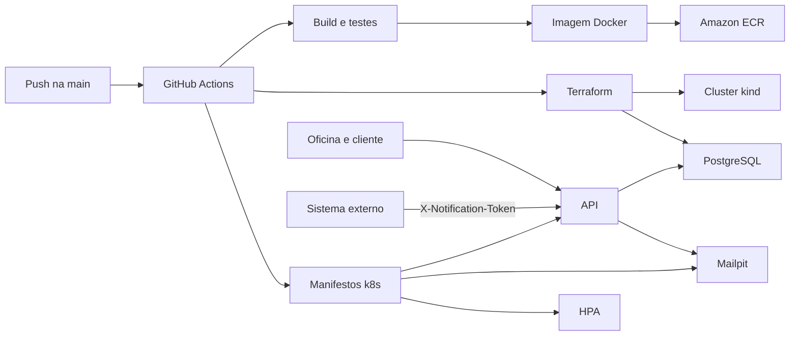

# Auto Repair Shop

API de um MVP de oficina mecânica (FIAP Tech Challenge, fases 1 e 2).

Monólito Kotlin/Spring Boot com DDD tático: usuários da oficina (JWT), clientes (CPF/CNPJ), veículos (placa brasileira), ordens de serviço, orçamento, itens de serviço e estoque (peças e insumos). Um único deployável, PostgreSQL, eventos in-process. A fase 2 coloca esse mesmo deployável em Kubernetes, com banco provisionado por Terraform e pipeline de build, teste, imagem e deploy.

Como subir o projeto: **[Getting started](docs/GETTING_STARTED.md)**.

## Fase 2

A oficina já operava o ciclo da OS. Esta fase deixa o atendimento abrir a ordem numa chamada só, consulta o status, recebe a decisão do orçamento de um sistema externo, organiza a fila de trabalho e sobe o ambiente de forma repetível.

### O que a API passou a fazer

| Fluxo | Como |
|---|---|
| Abertura da OS | `POST /service-orders` recebe cliente, veículo, serviços e peças e devolve o id da OS. Documento ou placa que já existem são reutilizados. |
| Status | `GET /service-orders/{id}/status` devolve `status` e o rótulo (Recebida, Diagnóstico, Aguardando Aprovação, Execução, Finalizada, Entregue, além de orçamento aprovado ou recusado). |
| Orçamento externo | `POST /integrations/budget-decisions` com `X-Notification-Token`. `APPROVED` ou `REJECTED`. |
| Fila | `GET /service-orders` ordena Em execução, orçamento aprovado, aguardando aprovação, diagnóstico, recebida e orçamento recusado. Mais antigas primeiro. `FINISHED` e `DELIVERED` saem da lista e continuam no banco. |
| E-mail de status | Cada transição envia e-mail ao contato do cliente (Mailpit em http://localhost:8025). |

Collection da API: pasta [`http/`](http/) (REST Client), em especial [`http/phase2.http`](http/phase2.http). Com a API no ar, Swagger em http://localhost:8080/swagger-ui.html e OpenAPI em http://localhost:8080/v3/api-docs.

Vídeo de até 15 minutos (deploy, CI/CD, consumo das APIs e escala automática): `https://www.youtube.com/watch?v=SUBSTITUA_PELO_VIDEO`

### Arquitetura e deploy



| Peça | Onde |
|---|---|
| Aplicação | Deployment `api`, Service NodePort `30080`, probes em `/actuator/health` |
| Banco | Deployment `postgres` + Service, aplicado pelo Terraform a partir de [`k8s/base`](k8s/base) |
| E-mail | Deployment `mailpit`, UI no NodePort `30025` |
| Configuração | ConfigMap `api-config` e Secret `api-secret` |
| Escala | HPA `api`, 2 a 5 réplicas, CPU 70% e memória 80%. O metrics-server entra no `terraform apply` |
| Cluster | [`infra/`](infra) cria um cluster kind e publica a API em `localhost:8080` e o Mailpit em `localhost:8025` |
| Pipeline | [`.github/workflows/cd.yml`](.github/workflows/cd.yml): testes, imagem versionada no Amazon ECR, `terraform apply`, `kind load`, `kubectl apply -k k8s` |

Os valores do Secret em `k8s/base/secret.yaml` são de desenvolvimento, iguais ao `.env.example`. Troque `JWT_SECRET` e `BUDGET_NOTIFICATION_TOKEN` antes de qualquer ambiente compartilhado.

### Execução local

Pré-requisitos e o fluxo com Gradle estão em [Getting started](docs/GETTING_STARTED.md).

```bash
cp .env.example .env
docker compose up --build
```

API em http://localhost:8080. Swagger em http://localhost:8080/swagger-ui.html. Mailpit em http://localhost:8025.

### Deploy em Kubernetes

Com um cluster já acessível pelo `kubectl` (Docker Desktop ou outro):

```bash
docker build -t auto-repair-shop:local .
kubectl apply -k k8s
kubectl -n auto-repair-shop rollout status deployment/api
```

No Docker Desktop a API fica em http://localhost:30080 e o Mailpit em http://localhost:30025. O metrics-server do Docker Desktop já cobre o HPA. Em kind, carregue a imagem (`kind load docker-image auto-repair-shop:local --name <cluster>`) antes do `kubectl apply`, porque o nó não enxerga o Docker do host.

### Provisionamento com Terraform

Recursos criados por `terraform apply` em [`infra/`](infra):

1. Cluster kind `autorepairshop`, com a porta do host `8080` ligada ao NodePort `30080` e a `8025` ligada ao NodePort `30025`.
2. metrics-server, com `--kubelet-insecure-tls`, para o HPA ter CPU e memória.
3. Namespace, ConfigMap, Secret e PostgreSQL descritos em [`k8s/base`](k8s/base). O volume do Postgres é `emptyDir`: os dados somem com o pod.

Pré-requisitos: Docker, [kind](https://kind.sigs.k8s.io/), kubectl, Terraform e bash.

O state do Terraform fica no bucket `fiap-group123-auto-repair-shop-tfstate`, não no Git. Na primeira vez, crie o bucket e inicialize o backend:

```bash
bash scripts/ensure-tfstate-bucket.sh
cd infra
terraform init
terraform apply
```

O apply não sobe a API. Publique a imagem no cluster e aplique o restante dos manifestos:

```bash
docker build -t auto-repair-shop:local .
kind load docker-image auto-repair-shop:local --name autorepairshop
kubectl apply -k k8s --context kind-autorepairshop
kubectl --context kind-autorepairshop -n auto-repair-shop rollout status deployment/api
```

API: http://localhost:8080. Mailpit: http://localhost:8025. Para derrubar o cluster: `terraform destroy` dentro de `infra/`.

Para o vídeo da escala, [`scripts/simulate-load.sh`](scripts/simulate-load.sh) baixa o alvo de CPU do HPA para 1% e gera tráfego. `kubectl -n auto-repair-shop get hpa -w` mostra as réplicas subindo. O script imprime o `kubectl patch` que devolve o alvo para 70%.

### CI/CD

Pull request: [`.github/workflows/pull-request-checks.yml`](.github/workflows/pull-request-checks.yml) compila, roda o Detekt e os testes com cobertura.

`main`, uma tag `v*` ou o disparo manual: [`.github/workflows/cd.yml`](.github/workflows/cd.yml) repete essas checagens, constrói a imagem e publica no Amazon ECR. Na branch, a tag é `sha-<12 caracteres do commit>` e também `latest`. Numa tag Git `v1.2.3`, a imagem recebe essa mesma versão. O deploy de demonstração no kind do runner continua usando a imagem local. Variáveis `JAVA_VERSION` (`17`), `GRADLE_VERSION` (`9.5.1`), `AWS_REGION` e o secret `AWS_ROLE_ARN` estão em [CONFIGURATION.md](docs/CONFIGURATION.md#github-actions).

## Documentação

| Documento                                         | Conteúdo |
|---------------------------------------------------|---|
| [GETTING_STARTED.md](docs/GETTING_STARTED.md)     | Pré-requisitos, Docker, Gradle, IDE, testes, qualidade, CI |
| [ENDPOINTS.md](docs/ENDPOINTS.md)                 | Rotas, papéis, request/response |
| [ERRORS.md](docs/ERRORS.md)                       | RFC 7807, status HTTP, exceção → status |
| [CONFIGURATION.md](docs/CONFIGURATION.md)         | Variáveis de ambiente, Compose, secrets do GitHub |
| [ARCHITECTURE.md](docs/ARCHITECTURE.md)           | Camadas, bounded contexts, fluxo, persistência |
| [ADR 001-postgresql.md](docs/adr/001-postgresql.md) | Por que PostgreSQL |
| [Auth HTTP](http/auth.http)                       | 1. Staff, login, convite |
| [Customer HTTP](http/customer.http)               | 2. Cliente e veículos |
| [Inventory HTTP](http/inventory.http)             | 3. Catálogo de estoque |
| [Service Order HTTP](http/service-order.http)     | 4. OS até a entrega (serviços + peças) |
| [Budget HTTP](http/budget.http)                   | OS à parte: negociar, depois delete |
| [Extra Service HTTP](http/extra-service.http)     | 5. Nova OS + extras |
| [Fase 2 HTTP](http/phase2.http)                   | Abertura completa, status, fila e notificação externa |

Cada `.http` é linear (de cima para baixo). Cada arquivo faz o próprio login. Ordem: **auth → customer → inventory → service-order → extra-service**. O `budget.http` pode rodar depois do `customer.http`. O `phase2.http` é independente e cadastra o próprio estoque. No convite, copie o token no [Mailpit](http://localhost:8025).

## O que a API cobre

| Contexto | Pacote | Responsabilidade |
|---|---|---|
| Access identity | `accessidentity` | Staff, convite do cliente, JWT + refresh |
| Customer | `customer` | Cliente (CPF/CNPJ) e veículos |
| Service and execution | `serviceandexecution` | Ciclo de vida da OS |
| Budget | `budget` | Total e aprovação do orçamento |
| Catalog | `catalog` | Itens de diagnóstico (`Service`) e extras (`ExtraService`) |
| Input management | `inputmanagment` | Estoque da oficina (`Inventory`) e linhas da OS (`Part`) |

Papéis: `MANAGER`, `RECEPTIONIST`, `MECHANIC`, `CLIENT`. Conta `CLIENT` só nasce pelo convite (e-mail de contato do cliente). Detalhe das rotas: [ENDPOINTS.md](docs/ENDPOINTS.md). Ciclo da OS:

```
RECEIVED → IN_DIAGNOSIS → WAITING_APPROVAL → BUDGET_APPROVED → IN_EXECUTION → FINISHED → DELIVERED
                              ↘ BUDGET_REJECTED
```

## Stack

| | |
|---|---|
| Linguagem | Kotlin 2.4.10, JDK 17 |
| Framework | Spring Boot 4.1.1 (Web MVC, Security, JPA, Validation, Mail, Actuator) |
| Auth | JWT HS256 (OAuth2 resource server), refresh no banco, senha BCrypt |
| Banco | PostgreSQL 16, Flyway, Hibernate `validate` |
| API docs | SpringDoc OpenAPI 3.1 / Swagger UI |
| Testes | JUnit 5, MockK, Testcontainers, ArchUnit, Kover (mín. **80%** de linha no núcleo) |
| Qualidade | Detekt + ktlint |
| Build | Gradle 9.5.1 (wrapper) |
| Runtime | Dockerfile + docker-compose (API, Postgres, Mailpit) |

## Comandos frequentes

```bash
./gradlew bootRun          # API no host (Postgres no Docker)
./gradlew unitTest         # @Tag("unit") — sem Testcontainers
./gradlew test             # todos os testes (precisa Docker)
./gradlew koverHtmlReport koverVerify
./gradlew detektMain
./gradlew check            # testes + Detekt
```

No Windows CMD/PowerShell use `gradlew.bat` no lugar de `./gradlew`.
